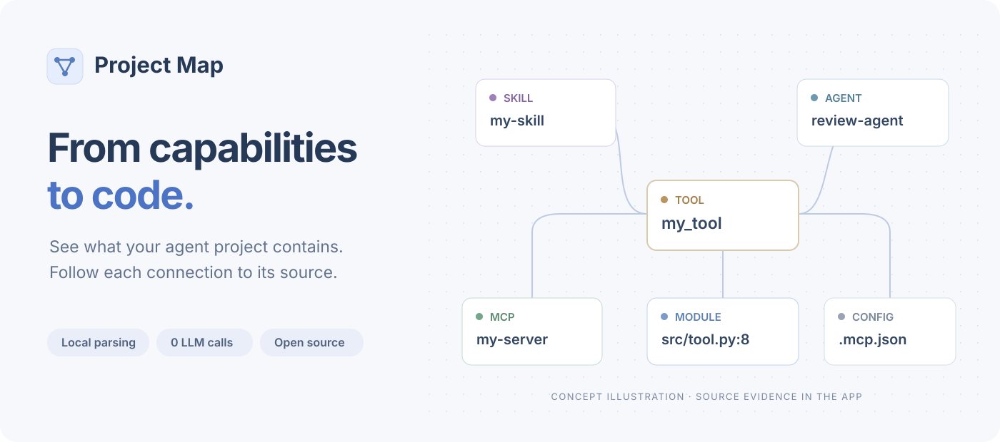

# Project Map

**A visual workspace for understanding agent projects.**

[Live demo](https://witazhang.github.io/project-map/) · [简体中文](README.zh-CN.md) · [Demo walkthrough](docs/demo.md) · [Contributing](CONTRIBUTING.md) · [MIT license](LICENSE)

Skills, agents, tools, MCP configuration, and implementation files often live in different parts of a repository. Project Map brings them onto one interactive canvas so you can follow a capability to its source and inspect the evidence behind each connection.

Import a project folder or ZIP. Parsing runs locally in your browser, with **zero LLM calls and no API key**. Names and descriptions come from source metadata, docstrings, and static strings.



**Status:** early-stage, read-only explorer. The current interface is in Chinese; this README describes its controls in English with their Chinese labels. The bundled example is synthetic.

## Try it

[Open Project Map](https://witazhang.github.io/project-map/) and choose **打开示例** to explore the included project immediately. Your imported source stays in your browser.

### Run locally

Development requires **Node.js 22.12 or newer** and npm. From this repository's directory:

```sh
git clone https://github.com/WItaZhang/project-map.git
cd project-map
npm ci
npm run dev
```

Open **http://127.0.0.1:4173** and choose **Open example / 打开示例**. No project, account, model key, or Python installation is needed to try the example.

To inspect your own project, use **Import project / 导入项目** → **Choose ZIP / 选择 ZIP 文件** or **Choose folder / 选择项目文件夹**. You can also drop a ZIP onto the app. Use a modern browser with module Web Worker support; ZIP import is available when directory selection is unavailable.

## From a capability to its implementation

A complete example using the included Career Agent:

1. **Start with a Skill.** Select `discover-jobs` in the browser or canvas. The map focuses on its immediate neighbors.
2. **Check the connection.** Open **Relationships / 关系**, find `search_jobs`, and select **Source / 出处**. The inspector shows the reference in `SKILL.md`, its path and line, and whether it is a declaration or a text mention.
3. **Find the implementation.** Select the `search_jobs` node, then **Code / 源码**. Its definition in `src/server.py` is highlighted. Copy the relative `path:line` to locate it in your editor.
4. **Explore the surrounding project.** Search names, descriptions, or paths; filter by object type; switch between **Overview / 全览** and **Focus / 聚焦**. Pan, zoom, drag nodes, or fit the canvas to the view.
5. **Make changes in your editor, then reimport.** The map is a snapshot of the imported files. It does not edit source files or watch the filesystem.


## What it recognizes

Support is based on explicit syntax and a small set of adapters. Finding a file from a framework does not imply full support for that framework.

| Input | Extracted objects and relationships | Current scope |
| --- | --- | --- |
| `SKILL.md` | Skill names, descriptions, declared tools, and document/tool mentions | YAML frontmatter and recognizable references in the instructions |
| Agent Markdown | Agent definitions and declared or mentioned tools | `.claude/agents/*.md`, `.codex/agents/*.md`, and `.github/agents/*.md`; selected matching Codex TOML adapters |
| Python | Modules, docstrings, project-local imports, decorated tools, and recognized MCP server instances | Static names in `@receiver.tool(...)`; a specific `Toolbox` / `@_tool(...)` registration adapter |
| JavaScript / TypeScript | Modules, relative imports, tool registrations, and recognized MCP SDK server instances | Top-level `server.registerTool(...)`, `server.tool(...)`, and exported `const … = tool(...)` patterns; JSX/TSX parsing included |
| MCP host configuration | Configuration nodes and declared server entries | `.mcp.json`, `mcp.json`, `.codex/config.toml`, and `.claude/settings.json`, using `mcpServers` or `mcp_servers` |
| Project configuration | Source entry points for configuration | Root `package.json`, `pyproject.toml`, and direct JSON/YAML/TOML files under `config/`, `configs/`, or `settings/` |

The scanner preserves missing descriptions as empty values. It does not generate explanations or infer a product architecture from filenames.

### Read the edges as evidence

Every relationship includes a source path, line number, and evidence text where available.

| Evidence | Meaning |
| --- | --- |
| Static source | A recognized import, registration, or implementation location exists in the source. |
| Explicit declaration | A document or configuration explicitly lists a tool or server. |
| Text reference | Instructions mention another recognized object. This does not establish execution. |
| Registry adapter candidate | A supported registration pattern connects candidate tools to a server; runtime configuration may expose a smaller set. |

A configured MCP endpoint and a server instance found in code keep separate identities, even when their names match. The app never starts or connects to either. Ambiguous names and unsupported dynamic registrations may remain unlinked.

## Privacy and execution boundaries

- **Local processing.** ZIP decompression and analysis run in a browser Web Worker. Folder files are read through the browser's file picker. Project contents are not uploaded, and the app makes no model or MCP requests.
- **Session memory.** Imported projects stay in memory for the current page session. There is no project database, account, cloud synchronization, or persisted workspace.
- **Text only.** Imported code is never executed. ZIP contents are not extracted onto your filesystem.
- **Explicit exclusions.** Dependency, build, data, and log directories are skipped, along with `.env*`, `profile.json`, and known credential files. The full rules are in [the importer](src/importer.js).
- **Limited redaction.** Recognized MCP host configurations retain key names and line positions while hiding values and comments. Ordinary source files and other configurations are not generally redacted; the exclusions are not a secret scanner.
- **Static distribution.** The production build bundles its dependencies locally and sets a Content Security Policy with `connect-src 'none'`. Loading the app still downloads its application assets from the host.

See [SECURITY.md](SECURITY.md) for security reporting.

## Limits worth knowing

| Resource | Limit |
| --- | --- |
| Compressed ZIP | 50 MiB |
| Selected source files | 2,000 |
| Individual source file | 1 MiB; larger files are skipped |
| Total selected text | 20 MiB |
| ZIP directory entries | 50,000 |

Source text and ZIP filenames must be UTF-8. Standard Store/Deflate ZIPs are supported; encrypted, multipart, and ZIP64 archives are not. ZIP symbolic links are skipped, and invalid or duplicate source paths are rejected.

The overview draws up to 36 objects; a focused map shows the selected object and up to 14 neighbors. The inspector retains the complete relationship list. For large projects, use type filters and search instead of rendering every file at once.

This version does not provide a complete call graph, runtime traces, dependency-injection resolution, dynamic registration discovery, or a guaranteed change-impact analysis. JavaScript import resolution is limited to project-relative paths. Reimport after changes; source editing, live filesystem watching, and GitHub synchronization are not implemented.

## Develop and self-host

```sh
npm test
npm run build
```

The static build is written to `dist/`. Serve that directory over HTTP(S), either at the origin root or under a path such as `/project-map/`. Asset URLs are relative. End users need only a browser. There is no application backend to deploy.

| File | Responsibility |
| --- | --- |
| [`src/importer.js`](src/importer.js) | ZIP/folder input, exclusions, path validation, and resource limits |
| [`src/analyze.js`](src/analyze.js) | Deterministic extraction and evidence-bearing relationships |
| [`src/worker.js`](src/worker.js) | Background decompression and analysis |
| [`src/main.js`](src/main.js) | Import lifecycle, progress, cancellation, and UI integration |
| [`src/ui.js`](src/ui.js), [`src/style.css`](src/style.css) | Canvas navigation, object browser, and source inspector |
| [`src/demo.js`](src/demo.js) | Synthetic example files |
| [`tests/`](tests/) | Import, parser, and DOM behavior tests |

The parsers use Babel, Lezer Python, YAML, and smol-toml; ZIP handling uses fflate. The app uses native JavaScript modules and SVG, with esbuild for packaging.

## Contribute

See [CONTRIBUTING.md](CONTRIBUTING.md) for setup and the contribution workflow. Useful contributions include small parser adapters, reproducible missing-link cases, clearer graph interactions, and accessibility improvements.

For parser changes, include a minimal synthetic fixture and test both the discovered object and its evidence location. Document unsupported cases rather than guessing relationships. For UI changes, check empty, importing, loaded, and failed-import states, including a narrow viewport. Keep private project content out of fixtures, screenshots, and issues.

## Roadmap

Directions for future work; these are not implemented features:

- English UI and localization.
- More registration adapters and language coverage, backed by source evidence and fixtures.
- Saved layouts and exportable maps.
- Snapshot comparisons to inspect how a project's structure changes.

## License

[MIT](LICENSE).
