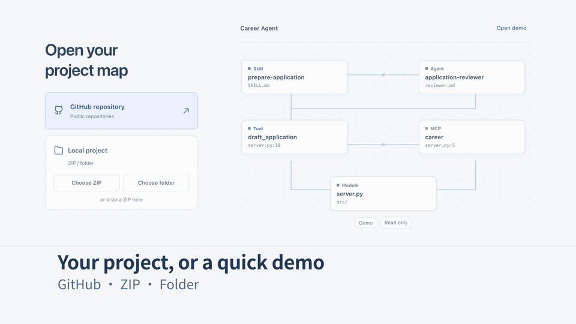

# Project Map

**A visual workspace for understanding agent projects.**

[Live demo](https://witazhang.github.io/project-map/) · [Watch the video](#watch-the-walkthrough) · [简体中文](README.zh-CN.md) · [Walkthrough guide](docs/demo.md) · [Contributing](CONTRIBUTING.md) · [MIT license](LICENSE)

Skills, agents, tools, MCP configuration, and implementation files often live in different parts of a repository. Project Map brings them onto one interactive canvas so you can follow a capability to its source and inspect the evidence behind each connection.

Connect a public GitHub repository, or import a project folder or ZIP. Parsing runs in your browser, with **zero LLM calls and no API key**. Names and descriptions come from source metadata, docstrings, and static strings.

**Status:** early-stage, read-only explorer with **English and 简体中文** interfaces. Switch languages in the top bar without losing your place. The bundled example is synthetic.

## Watch the walkthrough

**English · 96 seconds · 1080p.** Import a project, follow a Skill to its tool and source line, then connect directly to a GitHub repository. English titles and guidance accompany real recordings of the v0.2 Chinese interface, with music and no narration.

https://github.com/user-attachments/assets/7801e032-a8e9-4176-af01-445ecaa39572

[English MP4](https://github.com/WItaZhang/project-map/releases/download/v0.2.0/project-map-walkthrough-en.mp4) · [中文视频](README.zh-CN.md#观看完整演示) · [中文 MP4](https://github.com/WItaZhang/project-map/releases/download/v0.2.0/project-map-walkthrough-zh.mp4) · [Editable video project](video/README.md)

<details>
<summary>Short animated preview</summary>



</details>

## Try it

[Open Project Map](https://witazhang.github.io/project-map/) and choose **Open demo** or click an object in the sample map. Connect a public repository with **GitHub repository**, or choose a local ZIP or folder.

The **中文 / EN** control switches the whole interface instantly. Your browser language sets the initial choice; your preference is saved on this device. Project names, descriptions and code stay in their original language.

### Connect GitHub

1. Choose **GitHub repository / GitHub 仓库** on the welcome screen, or **Add project → Connect GitHub**.
2. Paste `https://github.com/owner/repo` or `owner/repo`, then choose **Find repository / 读取仓库**.
3. Select a branch and choose **Connect repository / 连接仓库**. The app reads the cloud file tree and supported source files directly from GitHub. You do not need to download a ZIP or clone the repository.
4. Explore the map. The sidebar records the branch and commit. **View on GitHub / 在 GitHub 查看** opens the relevant source line at that same commit.
5. After pushing changes to GitHub, choose **Refresh from GitHub / 从 GitHub 刷新** to read the branch again.

GitHub remains the source of the project; analysis runs in your browser. Each load is a consistent commit snapshot. This connection currently supports public repositories without sign-in; it does not watch for changes, write commits, or create a cloud workspace.

### Run locally

Development requires **Node.js 22.12 or newer** and npm. From this repository's directory:

```sh
git clone https://github.com/WItaZhang/project-map.git
cd project-map
npm ci
npm run dev
```

Open **http://127.0.0.1:4173** and choose **Open demo / 打开示例**. No project, account, model key, or Python installation is needed to try the example.

For a local project, use **Add project / 导入项目** → **Choose ZIP / 选择 ZIP 文件** or **Choose folder / 选择项目文件夹**. You can also drop a ZIP onto the app. Use a modern browser with module Web Worker support; ZIP import is available when directory selection is unavailable.

## From a capability to its implementation

A complete example using the included Career Agent:

1. **Start with a Skill.** Select `discover-jobs` in the browser or canvas. The map focuses on its immediate neighbors.
2. **Check the connection.** Open **Relations / 关系**, find `search_jobs`, and select **Evidence / 出处**. The inspector shows the reference in `SKILL.md`, its path and line, and whether it is a declaration or a text mention.
3. **Find the implementation.** Select the `search_jobs` node, then **Source / 源码**. Its definition in `src/server.py` is highlighted. Copy the relative `path:line` to locate it in your editor.
4. **Explore the surrounding project.** Search names, descriptions, or paths; filter by object type; switch between **Overview / 全览** and **Focus / 聚焦**. Pan, zoom, drag nodes, or fit the canvas to the view.
5. **Make changes in your editor, then refresh.** Reimport local files, or push your changes and choose **Refresh from GitHub** for a connected repository. The map shows a snapshot; it does not edit source files or watch for changes.

## What it recognizes

Support is based on explicit syntax and a small set of adapters. Finding a file from a framework does not imply full support for that framework.

| Input | Extracted objects and relationships | Current scope |
| --- | --- | --- |
| `SKILL.md` | Skill names, descriptions, declared tools, and document/tool mentions | YAML frontmatter and recognizable references in the instructions |
| Agent Markdown | Agent definitions and declared or mentioned tools | `.claude/agents/*.md`, `.codex/agents/*.md`, and `.github/agents/*.md`; selected matching Codex TOML adapters |
| Python | Modules, docstrings, project-local imports, decorated tools, and recognized MCP server instances | Static names in `@receiver.tool(...)`; a specific `Toolbox` / `@_tool(...)` registration adapter |
| JavaScript / TypeScript | Modules, relative imports, tool registrations, and recognized MCP SDK server instances | Top-level `server.registerTool(...)`, `server.tool(...)`, and exported `const … = tool(...)` patterns; JSX/TSX parsing included |
| MCP host configuration | Configuration nodes and declared server entries | `.mcp.json`, `mcp.json`, `.codex/config.toml`, and `.claude/settings.json`, using `mcpServers` or `mcp_servers` |
| Project configuration | Source entry points for configuration | Root `package.json`, `pyproject.toml`, and direct JSON/YAML/TOML files under `config/`, `configs/`, or `settings/` |

The scanner preserves missing descriptions as empty values. It does not generate explanations or infer a product architecture from filenames.

### Read the edges as evidence

Every relationship includes a source path, line number, and evidence text where available.

| Evidence | Meaning |
| --- | --- |
| Static source | A recognized import, registration, or implementation location exists in the source. |
| Explicit declaration | A document or configuration explicitly lists a tool or server. |
| Text reference | Instructions mention another recognized object. This does not establish execution. |
| Registry adapter candidate | A supported registration pattern connects candidate tools to a server; runtime configuration may expose a smaller set. |

A configured MCP endpoint and a server instance found in code keep separate identities, even when their names match. The app never starts or connects to either. Ambiguous names and unsupported dynamic registrations may remain unlinked.

## Privacy and execution boundaries

- **Local imports.** ZIP decompression and analysis run in a browser Web Worker. Folder files are read through the browser's file picker. Local project contents are not sent over the network. The app makes no model or MCP requests.
- **GitHub connection.** Only when you connect or refresh a repository, the browser sends read-only GET requests to `api.github.com` and `raw.githubusercontent.com`. GitHub receives those repository/file requests and your network connection information. No token, local project content, or source changes are uploaded.
- **Snapshot memory.** The active project snapshot is held in page memory. There is no project database, account, or persisted workspace. The browser may cache immutable GitHub source responses according to its HTTP cache settings.
- **Text only.** Imported code is never executed. ZIP contents are not extracted onto your filesystem.
- **Explicit exclusions.** Dependency, build, data, and log directories are skipped, along with `.env*`, `profile.json`, and known credential files. The full rules are in [the importer](src/importer.js).
- **Limited redaction.** Recognized MCP host configurations retain key names and line positions while hiding values and comments. Ordinary source files and other configurations are not generally redacted; the exclusions are not a secret scanner.
- **Static distribution.** The production build bundles dependencies locally. Its Content Security Policy permits data connections only to the GitHub API and raw-source hosts. Loading the app also fetches its application assets from the host.

See [SECURITY.md](SECURITY.md) for security reporting.

## Limits worth knowing

| Resource | Limit |
| --- | --- |
| Compressed ZIP | 50 MiB |
| Selected source files | 2,000 |
| Individual source file | 1 MiB; larger files are skipped |
| Total selected text | 20 MiB |
| ZIP or GitHub tree entries | 50,000 |
| GitHub branch choices | 1,000 |

Source text and ZIP filenames must be UTF-8. Standard Store/Deflate ZIPs are supported; encrypted, multipart, and ZIP64 archives are not. ZIP symbolic links are skipped, and invalid or duplicate source paths are rejected.

GitHub connections use the anonymous public API quota, which is shared by requests from your IP address. GitHub currently allows 60 unauthenticated API requests per hour; a connection uses several metadata requests, while source files are read from the raw-source host. If the quota is exhausted, wait for the indicated reset. See [GitHub's rate-limit documentation](https://docs.github.com/en/rest/using-the-rest-api/rate-limits-for-the-rest-api). Truncated GitHub trees are rejected rather than displayed as complete; symlinks and submodules are skipped.

The overview draws up to 36 objects; a focused map shows the selected object and up to 14 neighbors. The inspector retains the complete relationship list. For large projects, use type filters and search instead of rendering every file at once.

This version does not provide a complete call graph, runtime traces, dependency-injection resolution, dynamic registration discovery, or a guaranteed change-impact analysis. JavaScript import resolution is limited to project-relative paths. Reimport local files or refresh the connected GitHub branch after changes. Source editing, automatic watching, private-repository authorization, and writing back to GitHub are not implemented.

## Develop and self-host

```sh
npm test
npm run build
```

The static build is written to `dist/`. Serve that directory over HTTP(S), either at the origin root or under a path such as `/project-map/`. Asset URLs are relative. End users need only a browser. There is no application backend to deploy.

| File | Responsibility |
| --- | --- |
| [`src/importer.js`](src/importer.js) | ZIP/folder input, exclusions, path validation, and resource limits |
| [`src/github.js`](src/github.js) | Public repository/branch discovery and commit-pinned cloud source reads |
| [`src/analyze.js`](src/analyze.js) | Deterministic extraction and evidence-bearing relationships |
| [`src/worker.js`](src/worker.js) | Background decompression and analysis |
| [`src/main.js`](src/main.js) | Import lifecycle, progress, cancellation, and UI integration |
| [`src/ui.js`](src/ui.js), [`src/style.css`](src/style.css) | Canvas navigation, object browser, and source inspector |
| [`src/demo.js`](src/demo.js) | Synthetic example files |
| [`tests/`](tests/) | Import, parser, and DOM behavior tests |

The parsers use Babel, Lezer Python, YAML, and smol-toml; ZIP handling uses fflate. The app uses native JavaScript modules and SVG, with esbuild for packaging.

## Contribute

See [CONTRIBUTING.md](CONTRIBUTING.md) for setup and the contribution workflow. Useful contributions include small parser adapters, reproducible missing-link cases, clearer graph interactions, and accessibility improvements.

For parser changes, include a minimal synthetic fixture and test both the discovered object and its evidence location. Document unsupported cases rather than guessing relationships. For UI changes, check both languages in empty, importing, loaded, and failed-import states, including a narrow viewport. See the [interface design notes](docs/interface-design.md) for the design approach and reviewed skills. Keep private project content out of fixtures, screenshots, and issues.

## Roadmap

Directions for future work; these are not implemented features:

- More registration adapters and language coverage, backed by source evidence and fixtures.
- Saved layouts and exportable maps.
- Snapshot comparisons to inspect how a project's structure changes.

## License

[MIT](LICENSE).
