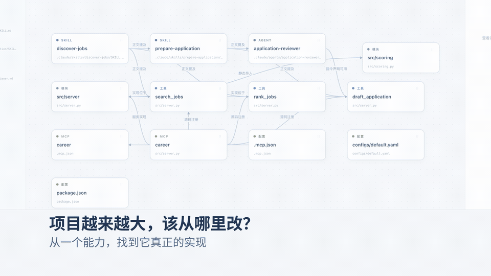

# Project Map

**用一张可操作的地图，理解 Agent 项目的能力与实现。**

[在线体验](https://witazhang.github.io/project-map/) · [观看视频](#观看完整演示) · [English](README.md) · [演示指南](docs/demo.md) · [参与贡献](CONTRIBUTING.md) · [MIT 许可证](LICENSE)

Skill、Agent、工具、MCP 配置和实现代码往往散落在仓库各处。Project Map 把它们放到同一张画布上，让你从产品能力出发找到源文件，并核对每条关系的依据。

连接公开 GitHub 仓库，或导入项目文件夹与 ZIP，即可在浏览器中解析。**零 LLM 调用，无需 API key。** 名称和描述来自源码元数据、docstring 与静态字符串。

**当前状态：**早期只读浏览工具，支持**中文和英文**，可在顶栏随时切换，保留当前浏览位置。内置项目是合成示例。

## 观看完整演示

**中文版 · 96 秒 · 1080p。** 从导入项目、查看 Skill 和工具的关系、定位源码，到直接连接 GitHub 仓库，展示真实操作全流程。基于 v0.2 界面录制，配有中文屏幕说明和音乐，无旁白。

https://github.com/user-attachments/assets/29cd2997-e29a-428d-8846-53f38b90006f

[下载中文 MP4](https://github.com/WItaZhang/project-map/releases/download/v0.2.0/project-map-walkthrough-zh.mp4) · [English video](README.md#watch-the-walkthrough) · [下载英文 MP4](https://github.com/WItaZhang/project-map/releases/download/v0.2.0/project-map-walkthrough-en.mp4) · [可编辑视频工程](video/README.md)

<details>
<summary>查看动图预览</summary>



</details>

## 在线体验

[打开 Project Map](https://witazhang.github.io/project-map/)，点击「**打开示例**」或示例地图中的对象即可体验。也可以点击「**GitHub 仓库**」，或选择本地 ZIP 与文件夹。

顶栏「**中文 / EN**」可即时切换整个界面。首次跟随浏览器语言，之后记住本机选择。项目名称、原始描述和代码保留原文。

### 连接 GitHub

1. 在欢迎页点击「**GitHub 仓库**」，或选择「**导入项目 → 连接 GitHub**」。
2. 粘贴 `https://github.com/owner/repo` 或 `owner/repo`，点击「**读取仓库**」。
3. 选择分支，点击「**连接仓库**」。应用直接读取 GitHub 云端目录和支持的源文件，无需你先下载 ZIP 或克隆仓库。
4. 在地图中探索项目。侧栏显示分支与 commit；「**在 GitHub 查看**」会打开同一 commit 下的对应源码行。
5. 把代码修改推送到 GitHub 后，点击「**从 GitHub 刷新**」读取分支的最新状态。

GitHub 是项目的数据来源，分析在浏览器中进行；每次读取都固定到同一个 commit。当前无需登录即可连接公开仓库，不会自动监听变化、写入提交或建立云端工作区。

## 本地体验

开发环境需要 **Node.js 22.12 或更新版本**和 npm。在本仓库目录运行：

```sh
git clone https://github.com/WItaZhang/project-map.git
cd project-map
npm ci
npm run dev
```

打开 **http://127.0.0.1:4173**，点击「**打开示例**」。体验示例无需准备项目、注册账号、配置模型密钥或安装 Python。

查看本地项目时，选择「**导入项目 → 选择 ZIP 文件 / 选择项目文件夹**」，也可以直接把 ZIP 拖入应用。浏览器需要支持 ES module Web Worker；如果没有文件夹选择功能，可以使用 ZIP。

## 从能力找到实现

用内置 Career Agent 示例走完一次完整流程：

1. **从 Skill 进入。** 在左侧列表或画布选择 `discover-jobs`，地图会聚焦它的一跳邻居。
2. **核对关系。** 在「**关系**」中找到 `search_jobs`，点击「**出处**」。检查器会展示 `SKILL.md` 中对应的引用、路径和行号，并标明它来自显式声明还是正文提及。
3. **定位实现。** 选择 `search_jobs` 工具节点，进入「**源码**」，查看 `src/server.py` 中高亮的定义位置。复制相对 `路径:行号`，即可在自己的编辑器中定位。
4. **浏览周边结构。** 按名称、原始描述或路径搜索，用类型筛选缩小范围，在「**全览**」和「**聚焦**」之间切换。画布支持平移、缩放、拖动节点和适应视图。
5. **在编辑器中修改，再刷新。** 本地项目重新导入；连接的仓库在推送后点击「**从 GitHub 刷新**」。地图反映一次读取的快照，不会写入源码或自动监听变化。

## 能识别什么

解析依靠明确的语法和少量适配规则。识别出某个框架的文件，不代表完整支持该框架。

| 输入 | 提取的对象与关系 | 当前范围 |
| --- | --- | --- |
| `SKILL.md` | Skill 名称、描述、声明的工具，以及文档或工具引用 | YAML frontmatter 与指令中的可识别引用 |
| Agent Markdown | Agent 定义、声明或提及的工具 | `.claude/agents/*.md`、`.codex/agents/*.md`、`.github/agents/*.md`，以及部分名称匹配的 Codex TOML 适配文件 |
| Python | 模块、docstring、项目内导入、装饰器工具和可识别的 MCP 服务实例 | 静态名称的 `@receiver.tool(...)`；特定的 `Toolbox` / `@_tool(...)` 注册模式 |
| JavaScript / TypeScript | 模块、相对导入、工具注册和可识别的 MCP SDK 服务实例 | 顶层 `server.registerTool(...)`、`server.tool(...)`、导出的 `const … = tool(...)`；包含 JSX/TSX 语法解析 |
| MCP 宿主配置 | 配置节点和声明的服务条目 | `.mcp.json`、`mcp.json`、`.codex/config.toml`、`.claude/settings.json` 中的 `mcpServers` 或 `mcp_servers` |
| 项目配置 | 可定位和查看的配置源文件入口 | 根目录 `package.json`、`pyproject.toml`，以及 `config/`、`configs/`、`settings/` 直接下属的 JSON/YAML/TOML 文件 |

源码没有提供描述时，描述保持为空。应用不会生成摘要，也不会根据文件名推测产品架构。

### 每条边都有依据

关系附带源路径、行号，以及可获取的证据原文。

| 依据 | 含义 |
| --- | --- |
| 静态源码 | 源文件中存在可识别的导入、注册或实现位置。 |
| 显式声明 | 指令或配置明确列出了某个工具或服务。 |
| 文本引用 | 指令提到了另一个已识别对象，不代表实际执行。 |
| 注册适配候选 | 受支持的注册模式把候选工具关联到服务；运行配置可能只暴露其中一部分。 |

配置中的 MCP 端点与代码中的服务实例分别保留身份，同名也不会自动合并。应用不会启动或连接它们。名称有歧义、或使用不支持的动态注册时，可能不建立关系。

## 隐私与执行边界

- **本地导入。** ZIP 解压和分析在浏览器 Web Worker 中进行，文件夹通过浏览器文件选择器读取。本地项目内容不发送到网络，应用不发起模型或 MCP 请求。
- **GitHub 连接。** 仅在连接或刷新仓库时，浏览器向 `api.github.com` 和 `raw.githubusercontent.com` 发起只读 GET 请求。GitHub 会收到仓库、文件请求及你的网络连接信息；应用不上传 token、本地项目内容或源码修改。
- **快照内存。** 当前项目快照保存在页面内存中，没有项目数据库、账号或持久化工作区。浏览器可能按 HTTP 缓存设置保留固定 commit 的 GitHub 源文件响应。
- **按文本读取。** 不执行导入的代码，也不把 ZIP 内容解压到你的文件系统。
- **明确排除。** 跳过依赖、构建、数据、日志目录，以及 `.env*`、`profile.json` 和已知凭据文件。完整规则见[导入器](src/importer.js)。
- **有限脱敏。** 已识别的 MCP 宿主连接配置保留键名和行位置，隐藏值与注释。普通源码和其他配置不做通用脱敏；这些排除规则不等于密钥扫描器。
- **静态发布。** 生产构建将依赖打包为本地资源，内容安全策略仅允许向 GitHub API 和原始源码域名建立数据连接。打开应用时还会从托管方加载应用资源。

安全问题的报告方式见 [SECURITY.md](SECURITY.md)。

## 已知限制

| 资源 | 上限 |
| --- | --- |
| 压缩 ZIP | 50 MiB |
| 选中的源文件数 | 2,000 |
| 单个源文件 | 1 MiB；超过则跳过 |
| 选中的文本总量 | 20 MiB |
| ZIP / GitHub 目录条目 | 50,000 |
| GitHub 分支选项 | 1,000 |

源文本和 ZIP 文件名需要 UTF-8 编码。支持普通 Store/Deflate ZIP，不支持加密、分卷和 ZIP64。ZIP 符号链接会被跳过，无效或重复的源路径会被拒绝。

GitHub 连接使用公开 API 的匿名额度，同一 IP 地址发起的请求会共用额度。GitHub 当前允许每小时 60 次匿名 API 请求；一次连接需要若干元数据请求，源文件从原始源码域名读取。额度用完后请等待提示的恢复时间，详见 [GitHub 额度说明](https://docs.github.com/en/rest/using-the-rest-api/rate-limits-for-the-rest-api)。应用会拒绝被 GitHub 截断的目录，避免把不完整结果当成完整项目；符号链接和子模块会被跳过。

全览最多绘制 36 个对象，聚焦视图展示所选对象及最多 14 个邻居，检查器保留完整关系列表。较大项目可以通过类型和搜索逐步定位。

当前不提供完整调用图、运行时轨迹、依赖注入解析、动态注册发现或可保证完整的改动影响分析。JavaScript 导入关系只解析项目内相对路径。文件变化后需重新导入本地项目，或刷新已连接的 GitHub 分支。源码编辑、自动监听、私有仓库授权和向 GitHub 写回尚未实现。

## 开发与自行托管

```sh
npm test
npm run build
```

静态构建输出到 `dist/`。通过 HTTP(S) 提供该目录，支持站点根路径或 `/project-map/` 这样的子路径；构建资源使用相对路径。最终用户只需要浏览器，无需部署应用后端。

| 文件 | 职责 |
| --- | --- |
| [`src/importer.js`](src/importer.js) | ZIP/文件夹读取、排除规则、路径检查和资源限制 |
| [`src/github.js`](src/github.js) | 公开仓库和分支发现、固定 commit 的云端源码读取 |
| [`src/analyze.js`](src/analyze.js) | 确定性提取对象和带证据的关系 |
| [`src/worker.js`](src/worker.js) | 后台解压和分析 |
| [`src/main.js`](src/main.js) | 导入生命周期、进度、取消和 UI 对接 |
| [`src/ui.js`](src/ui.js)、[`src/style.css`](src/style.css) | 画布、对象浏览器和源码检查器 |
| [`src/demo.js`](src/demo.js) | 合成示例文件 |
| [`tests/`](tests/) | 导入、解析和 DOM 行为测试 |

解析使用 Babel、Lezer Python、YAML 与 smol-toml，ZIP 处理使用 fflate。应用采用原生 JavaScript modules 和 SVG，由 esbuild 打包。

## 参与贡献

开发与提交流程见 [CONTRIBUTING.md](CONTRIBUTING.md)。欢迎补充小范围的解析适配、可复现的关系遗漏案例、画布交互与无障碍改进。

修改解析器时，请提供最小合成样例，同时测试对象识别和证据位置。对不支持的情况明确记录，避免猜测关系。修改 UI 时，请在中英两种语言下检查空状态、导入中、已加载和导入失败状态，并验证窄屏布局。界面设计方法和采用的 skill 见[设计记录](docs/interface-design.md)。测试样例、截图和 issue 中请勿包含私人项目内容。

## 后续方向

以下是后续计划方向，当前尚未实现：

- 更多有来源证据和测试样例的注册适配与语言支持。
- 保存布局和导出地图。
- 比较项目快照，查看结构变化。

## 许可证

[MIT](LICENSE)。
