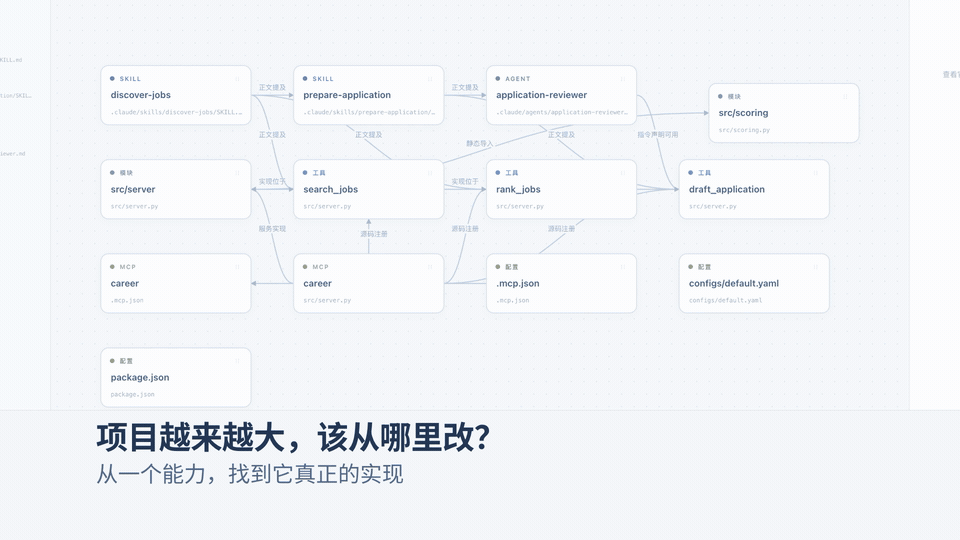
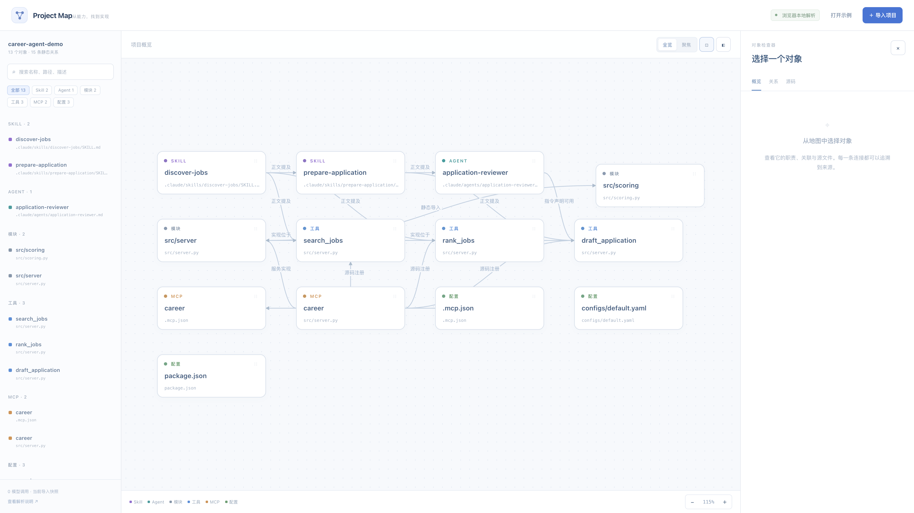

# Project Map — product walkthrough

[Open the live app](https://witazhang.github.io/project-map/) · [Watch the full video](https://github.com/WItaZhang/project-map/releases/download/v0.1.0/project-map-walkthrough-zh.mp4) · [Download the synthetic example](../examples/career-agent-demo.zip) · [中文说明](../README.zh-CN.md)

Follow one synthetic Career Agent project from import to a source definition. The bundled example contains no private project data.

## Watch the walkthrough

The video shows the actual app: import a ZIP, navigate the map, inspect a Skill's relationship evidence, find a tool's source, and distinguish MCP configuration from server instances. It uses Chinese on-screen text and music, without narration.

[Watch or download the full video (MP4)](https://github.com/WItaZhang/project-map/releases/download/v0.1.0/project-map-walkthrough-zh.mp4). To edit the scenes or render your own version, see the [video project](../video/README.md).

## Follow along

Use the [live app](https://witazhang.github.io/project-map/), or run `npm ci` and `npm run dev`, then open http://127.0.0.1:4173.

| Step | In the app | What you learn |
| --- | --- | --- |
| 1. Import | Choose **选择 ZIP** and open `examples/career-agent-demo.zip`; alternatively choose **打开示例** | Your source becomes a local snapshot. No model key is needed. |
| 2. Survey | Select **全部** and **全览** | Skills, agents, tools, MCP instances, modules, and configuration are distinct objects. |
| 3. Choose a capability | Select `discover-jobs` | The original description and nearby objects explain where to explore next. |
| 4. Verify a relationship | Open **关系**, find `search_jobs`, and choose **出处** | The reference is a text mention in `SKILL.md`, with a precise path and line. |
| 5. Find the tool | Select **工具**, search `search_jobs`, then select it | The tool has its own declaration and source location. |
| 6. Locate the implementation | Open **源码** | `src/server.py:8` is highlighted. **复制相对路径:行** copies the relative path and line for use in your editor. |
| 7. Inspect MCP | Select **MCP**, then a `career` entry | Configuration discoveries and source server instances remain distinct. No server connection is made. |
| 8. Keep developing | Change files in your editor, then import again | The current version is a read-only snapshot. It does not write changes back. |

## 中文操作说明

围绕同一个合成求职 Agent 项目，从导入到源码定位的完整操作流程：

[观看或下载完整视频](https://github.com/WItaZhang/project-map/releases/download/v0.1.0/project-map-walkthrough-zh.mp4)：真实应用录屏，中文屏幕文字，配乐，无旁白。需要调整画面或重新渲染时，查看[可编辑视频工程](../video/README.md)。

1. 导入 `career-agent-demo.zip`，或者先点「打开示例」。
2. 点「全部」和「全览」，查看六类对象；拖动、缩放画布。
3. 选择 `discover-jobs`，查看原始描述和一跳关系。
4. 在「关系」中找到 `search_jobs`，点「出处」，查看 Skill 中的原文依据。
5. 切到「工具」，搜索 `search_jobs`，再打开「源码」，定位 `src/server.py:8`。
6. 查看 MCP 对象，区分配置中的服务与源码中的实例。
7. 在编辑器修改项目，重新导入查看新快照。

演示涵盖浏览器本地解析、零 LLM 调用、原始描述提取，以及从关系回到来源的操作。当前版本不执行工具、不连接 MCP，也不修改项目；修改源码后需要重新导入。

